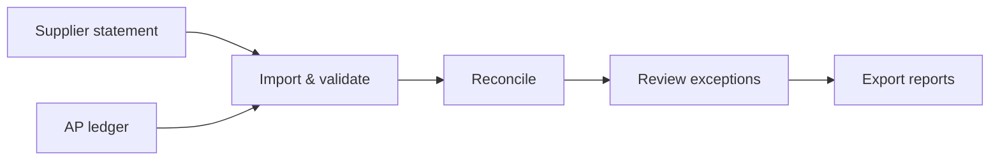

# StatementDesk

**Local-first supplier statement reconciliation for accounts payable workflows.**  
**Status:** v0.1.0 technical beta · macOS 13+ (Apple Silicon / Intel); Windows 11 x64 targeted

StatementDesk compares a supplier statement with an accounts payable (AP) ledger export, identifies discrepancies and provides a structured way to review and report exceptions. I built it to explore how financial controls and routine reconciliation work can be made clearer and less manual.

> **Product scope:** A single-supplier, AUD-only reconciliation tool. This is a technical beta, not a replacement for accounting controls or a completed financial audit. The current development builds are unsigned and have not completed clean-install verification on target operating systems.

## The problem and the approach

Reconciling a supplier statement against an AP ledger often means working through spreadsheets, inconsistent source formats, unmatched invoices, credits and duplicate references. A difference in headline balances tells you **that** something is wrong, but not necessarily **where** or **why**.

StatementDesk organises that process:

- **Import and validate:** Load CSV or XLSX files; map columns and date formats; check source totals and invalid rows.
- **Compare consistently:** Match by supplier, currency, document type, reference, date and amount. Monetary values are stored as integer cents to avoid floating-point comparisons.
- **Surface exceptions:** Separate exact matches from amount or date differences, unmatched items and ambiguous duplicates. Uncertain matches are flagged for review, not guessed.
- **Keep a review trail:** Record decisions and notes against exceptions in a local project file.
- **Produce an output:** Export Excel reconciliation workbooks, exceptions CSV files or printable HTML reports, subject to validation status.

All processing takes place locally without accounts, cloud synchronisation or telemetry during import, comparison, review or export. Project files are **not encrypted by the application**; use operating-system disk encryption for sensitive data.

## See it in action — synthetic example

The repository includes a reproducible example for a fictional supplier, **SUP001**. It shows how a balance discrepancy is broken down into reviewable exceptions.

| Sample outcome | Result |
|---|---:|
| Supplier statement | A$2,860.00 |
| AP ledger | A$2,533.00 |
| Balance difference | **A$327.00** |
| Exact matches | 4 |
| Exception groups | 4 |

The sample includes an amount difference, a statement-only item, an ambiguous duplicate and a ledger-only item. These are **synthetic fixtures**, not realised customer outcomes.

**[Open the step-by-step demo →](docs/DEMO.md)** · [Sample input files](samples/README.md) · [User guide](docs/USER_GUIDE.md)



*Visual walkthrough:* The [demo guide](docs/DEMO.md) describes the actual screens and how to capture verified screenshots from the running app with synthetic data. A recorded video or product screenshots have not yet been published.

## What this project demonstrates

- Translating a financial operations problem into explicit workflow and validation rules.
- Designing controls for data quality, ambiguous matches and traceable exception handling.
- Keeping the comparison engine separate from the desktop UI, with tests for financial edge cases.
- Building a local-first desktop workflow with typed interfaces, validated IPC, SQLite persistence and report generation.

**Stack:** TypeScript, Electron, React, SQLite (`better-sqlite3`), Zod, ExcelJS, Vitest and Playwright.

## Run locally

Requires Node.js 20+ and npm. Dependencies are pinned in `package-lock.json`.

```bash
npm install          # install dependencies and the Electron runtime
npm run dev          # start the desktop app in development
npm run lint         # type-aware ESLint
npm run typecheck    # TypeScript checks
npm test             # unit, property and integration tests
npm run test:e2e     # Playwright desktop tests (Linux: xvfb-run -a npm run test:e2e)
npm run build        # electron-vite bundle into out/
npm run dist:mac     # macOS DMG and ZIP for arm64 and x64
npm run dist:win     # Windows NSIS installer
npm run icons        # rebuild icons
```

On Home, choose **Try sample** to load the synthetic SUP001 example.

### Verification and release status

The [test and validation report](docs/TEST_AND_VALIDATION_REPORT.md) records 108 passing unit/property/integration tests, plus successful lint, typecheck and production bundle checks **at the time of that report**. Desktop end-to-end execution and target-OS installer verification are not yet complete for this beta; see the report and [release checklist](docs/RELEASE_CHECKLIST.md) before distributing builds.

The project is limited to a single supplier and AUD per reconciliation, accepts CSV/XLSX (not PDF), and does not verify the completeness of the underlying accounting ledger. See [known limitations](docs/KNOWN_LIMITATIONS.md).

## Repository layout

```text
src/main        Electron main process (windows, security, validated IPC)
src/preload     Narrow contextBridge API
src/renderer    React interface
src/shared      Shared types and Zod contracts
src/domain      Financial reconciliation engine
src/import      CSV / XLSX readers and mapping
src/storage     SQLite projects and migrations
src/export      Excel, CSV and HTML report writers
tests/          Unit, property, integration and e2e checks
samples/        Synthetic supplier statement and AP ledger
docs/           User and implementation documentation
scripts/        Build helpers
build/          Installer resources and signing hooks
```

## Documentation

- [Demo walkthrough](docs/DEMO.md) · [User guide](docs/USER_GUIDE.md) · [Supported formats](docs/SUPPORTED_FORMATS.md)
- [How it works](docs/IMPLEMENTATION_REPORT.md) · [Tests and validation](docs/TEST_AND_VALIDATION_REPORT.md)
- [Privacy](docs/PRIVACY.md) · [Known limitations](docs/KNOWN_LIMITATIONS.md) · [Troubleshooting](docs/TROUBLESHOOTING.md)
- [Release checklist](docs/RELEASE_CHECKLIST.md) · [Third-party notices](docs/THIRD_PARTY_NOTICES.md) · [SBOM](docs/sbom.json)

### Installer builds

Run `npm run dist:mac` on macOS or `npm run dist:win` on Windows. Native `better-sqlite3` dependencies must be built for the target OS. Unsigned builds are for development only. The macOS notarisation hook uses `APPLE_ID`, `APPLE_APP_SPECIFIC_PASSWORD` and `APPLE_TEAM_ID`; follow the release checklist for signing and clean-install checks.
