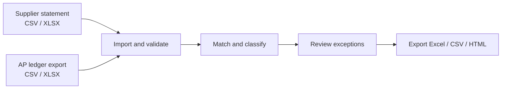

# StatementDesk demo — synthetic supplier reconciliation

This walkthrough uses the **synthetic SUP001 dataset** committed to the repository. No real supplier or company data is needed.

StatementDesk is a local-first desktop application for comparing a supplier statement with an accounts payable ledger export. It is a **technical beta**, not a production accounting system.

## Run the example

1. Install Node.js 20+ and run `npm install`, then `npm run dev` from the repository root.
2. On **Home**, choose **Try sample** to open the supplied SUP001 example. You can also start a **New reconciliation** and manually import the files from [`samples/`](../samples/README.md).
3. Check the import mappings (document reference, document type, date and outstanding amount). The sample deliberately uses different date formats in its two sources.
4. On **Validation**, inspect the statement and ledger totals and any rejected or excluded rows.
5. Open **Results** to see exact matches and exception groups, including an amount difference, a statement-only item, an ambiguous duplicate and a ledger-only item.
6. Open **Review** to record a decision or note against an exception; review history is saved in the local project.
7. Use **Export** to create an Excel reconciliation workbook or printable HTML report. A fixed-format exceptions CSV is available for runs without invalid rows.

## Expected results from the sample

| Measure | Expected result |
|---|---:|
| Supplier | SUP001 |
| Currency | AUD |
| Cut-off | 30 September 2026 |
| Supplier statement balance | A$2,860.00 |
| Accounts payable ledger balance | A$2,533.00 |
| Difference (statement less ledger) | **A$327.00** |
| Exact matches | 4 |
| Exception groups | 4 |

The exceptions are documented in the [sample fixtures](../samples/README.md): INV102 (+A$30 amount difference), INV103 (+A$220 statement-only), INV105 (+A$165 ambiguous duplicate) and INV106 (−A$88 ledger-only).

These figures describe **synthetic test data**, not customer results or realised cost savings.

## Workflow at a glance

## Capturing an authentic product walkthrough

Screenshots or a screen recording should be made **from the running application using the synthetic SUP001 project**. Suggested frames:

1. **Home** — the sample entry point
2. **Validation** — source totals and import checks
3. **Results** — matches, exception categories and the A$327 difference
4. **Review** — an example decision or note
5. **Export** — report format options

Capture only after verifying the application renders correctly on the chosen OS. Do not include personal paths, live supplier information, sensitive credentials or private accounting data.

## Further documentation

- [User guide](USER_GUIDE.md)
- [Implementation details](IMPLEMENTATION_REPORT.md)
- [Test and validation report](TEST_AND_VALIDATION_REPORT.md)
- [Known limitations](KNOWN_LIMITATIONS.md)
- [Release checklist](RELEASE_CHECKLIST.md)
